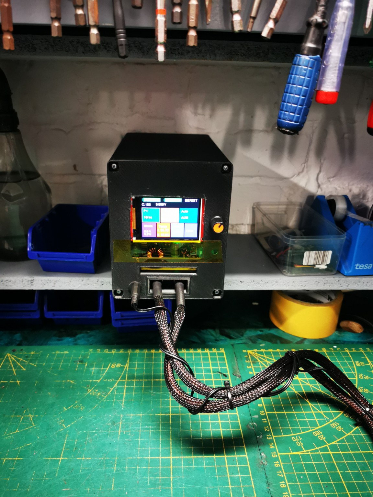
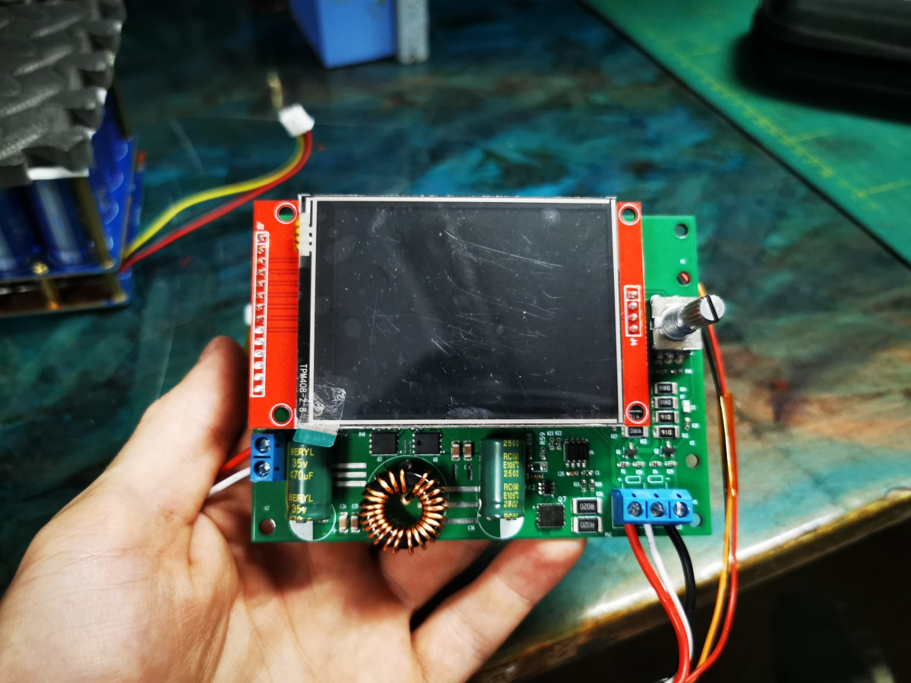
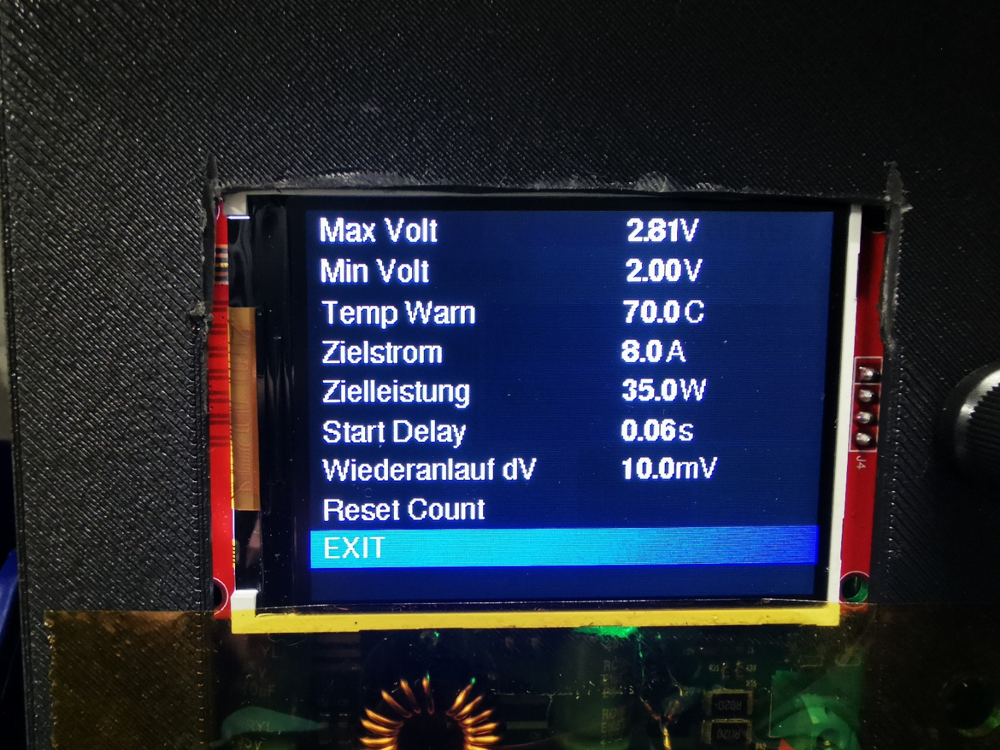
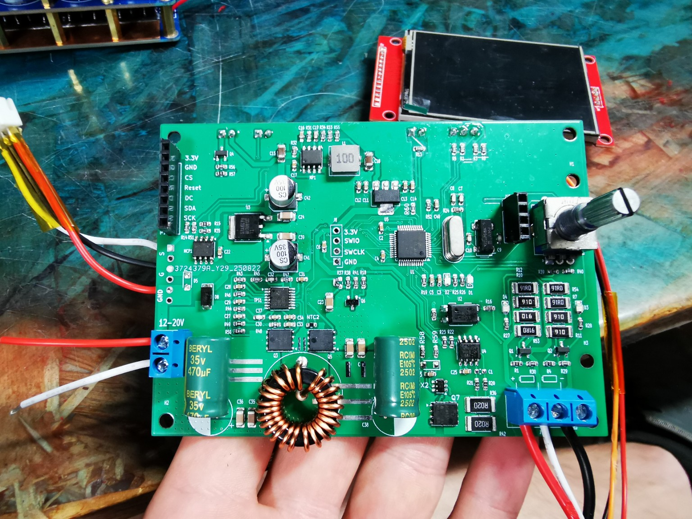
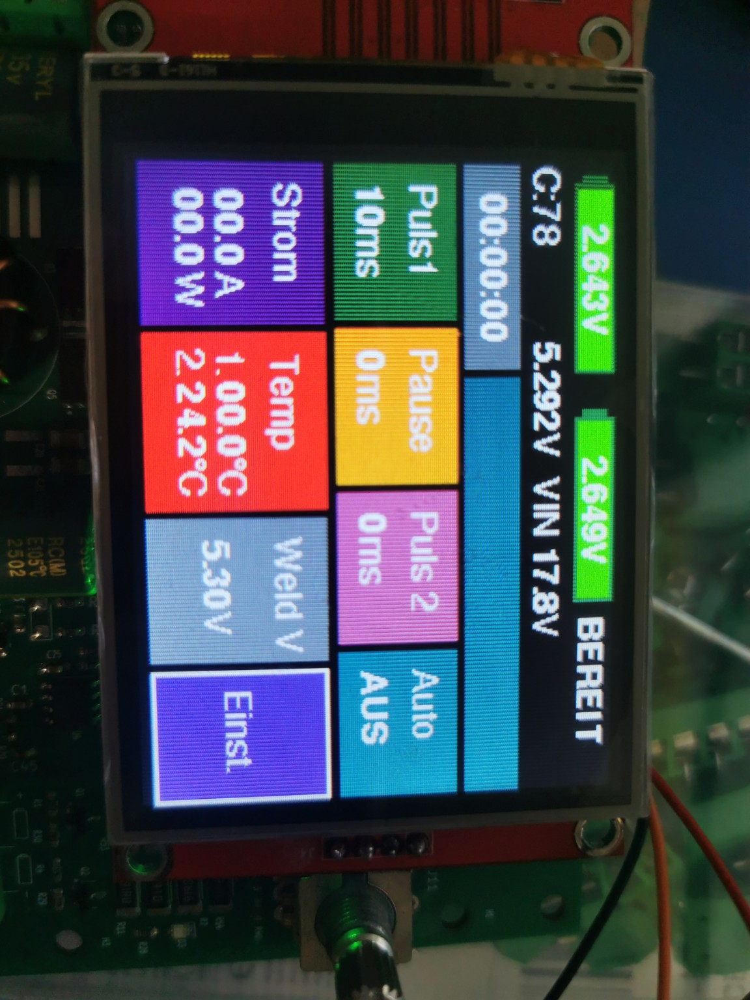

# STM32 Capacitor Spot Welder with TFT Display

DIY capacitor spot welder based on STM32 with TFT display, adjustable welding pulses, configurable charging control and safety features.

## Overview

This project is a self-built capacitor spot welder based on an STM32 microcontroller.  
It is designed for controlled battery tab welding with adjustable pulse settings, TFT user interface, voltage monitoring and configurable protection features.

### Proven in real use

- **Version 1:** over **100,000 weld points**
- **Current version:** over **30,000 weld points**

This is not just a prototype – the device has already been used extensively in practical operation.

## Main Features

- STM32-based control
- TFT display with menu interface
- Adjustable welding pulses
- Configurable pulse / pause / pulse timing
- Voltage monitoring
- Temperature monitoring
- Adjustable charge control
- Safety limits and warning thresholds
- Rotary encoder based user input

## User Interface

## Bilder / Images

### Fertiges Punktschweißgerät

### Bedienoberfläche

### Einstellungen

### Elektronik

### Weitere Ansicht

## Project Status

**Active development**  
The spot welder is functional and used regularly in real-world applications.

## Notes

This project is intended for users with experience in electronics and high-current systems.  
Working with capacitor discharge systems and battery welding can be dangerous if handled improperly.

## License

Apache-2.0

---

# Deutsch

## Übersicht

Dies ist ein selbstgebautes Punktschweißgerät auf STM32-Basis mit TFT-Display.  
Es ist für kontrolliertes Akkuschweißen ausgelegt und bietet einstellbare Schweißpulse, Spannungsüberwachung, Temperaturüberwachung sowie verschiedene Schutzfunktionen.

### In der Praxis bewährt

- **Version 1:** über **100.000 Schweißpunkte**
- **Aktuelle Version:** über **30.000 Schweißpunkte**

Das Projekt ist also nicht nur ein Prototyp, sondern wurde bereits intensiv praktisch eingesetzt.

## Hauptfunktionen

- STM32-basierte Steuerung
- TFT-Display mit Menüoberfläche
- Einstellbare Schweißpulse
- Konfigurierbare Puls-/Pausenzeiten
- Spannungsüberwachung
- Temperaturüberwachung
- Einstellbare Ladeparameter
- Schutz- und Warnschwellen
- Bedienung per Drehencoder

## Projektstatus

**Aktiv in Entwicklung**  
Das Gerät ist funktionsfähig und wird regelmäßig im praktischen Einsatz verwendet.

## 💖 Support this project

If you like this project and want to support its development:

👉 https://paypal.me/Zaharg

Thank you! 🙏

